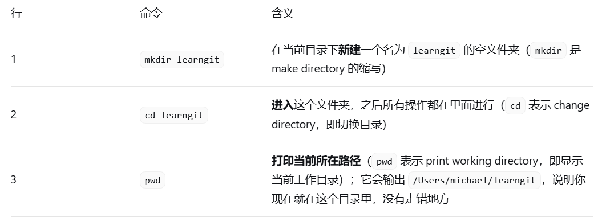
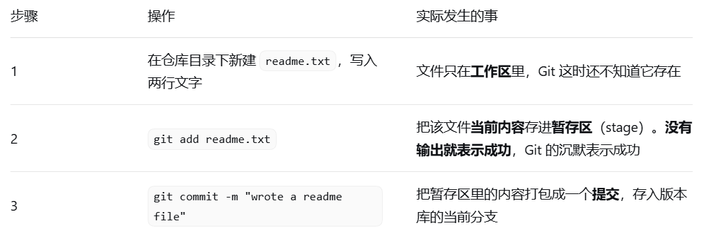
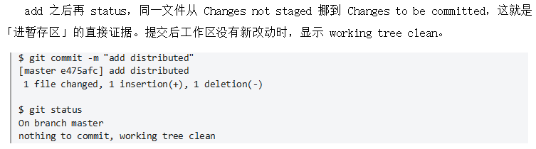
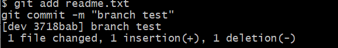
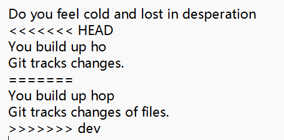
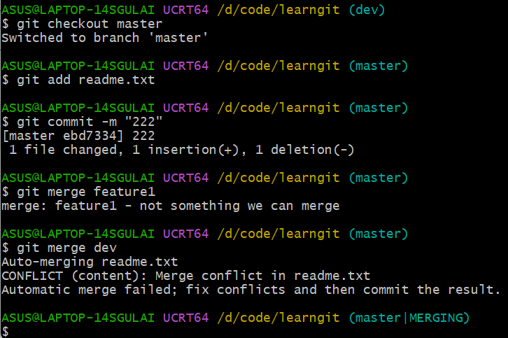

# Git 笔记

> 对应：第 1 周 第 3 天 · 版本管理与笔记
> 完成时间：2026-10-14 ~ 2026-10-21（上周）
> 来源：课题组任务/Git 笔记.docx

---

Git学习梗概

一、初始配置

在配置身份时要写明自己的中央账号

> \$ git config \--global user.name \"Your Name\"\
> \$ git config \--global user.email \"email\@example.com\"

Global代表机器上所有仓库都使用这个配置 若不使用则只对这个仓库起作用

（自检清单）

**1.** 在终端输入 **git -v**，能打出版本号。

**2.** 输入 **git config \--global user.name**，能回显你配置的名字。

**3.** 输入 **git config \--global user.email**，能回显邮箱。

每次运行前都试一次

2.  版本库与第一次提交

    版本库：**项目的 "时光机 + 存档柜"**，把你所有代码 / 文件的每一次改动都保存下来，方便回溯、对比、多人协作。 分为本地仓库与远程仓库两个部分

    1.建库

**1.** 选一个位置创建空目录，并确认当前路径：

> \$ mkdir learngit\
> \$ cd learngit\
> \$ pwd\
> /Users/michael/learngit

代码解读

> 

**2.** 把该目录变成 Git 仓库：

> \$ git init\
> Initialized empty Git repository in /Users/michael/learngit/.git/

**3.** 确认 .git 目录已生成（它是隐藏目录，用 **ls -ah** 才看得到）：

> \$ ls -ah\
> . .. .git

2.将文件提交到仓库

> 第一步：Git is a version control system.\
> Git is free software.
>
> 第二步：git add readme.txt
>
> 第三步：git commit -m \"wrote a readme file\"\
> \[master (root-commit) eaadf4e\] wrote a readme file\
> 1 file changed, 2 insertions(+)\
> create mode 100644 readme.txt

注意：删去文件也算是改动，需要向系统报备：git add 删去的文件名.后缀

拓展：一次提交多个文件（前提是得已经有这两个文件了）

git add file1.txt\
git add file2.txt file3.txt\
git commit -m \"add 3 files.\"（报备）

建立库存时的注意事项

**只擅长文本**：Git 能逐行跟踪 TXT、网页、源码的改动；图片、视频、Word 这类二进制文件只能记录「从 100KB 变成 120KB」，看不到改了什么。要享受版本控制，就用纯文本写。

> · **编码统一 UTF-8**：Windows 记事本会在文件头偷偷加 0xefbbbf，导致网页首行出现乱码、程序编译报语法错误；换用 VS Code 等编辑器，统一保存为 UTF-8。
>
> · **目录名不要用中文**：Windows 下仓库路径（含上级目录）带中文容易引发各种莫名其妙的问题。
>
> · **别拿生产项目练手**：学习阶段新建独立目录，出问题直接删掉重来。
>
> 3.状态查询

status 看整体（只检查文件名）检查有没有改动需要提交，弹出working tree clean就是干净的意思

diff 看细节（看文件里具体改了什么）

log 看历史（看之前改动了什么）

  ---------------------------- ----------------------- -------------------------------------
  **命令**                     **比较的是**            **什么时候用**
  git diff                     工作区 ↔ 暂存区         看「还没 add 的改动」
  git diff \--staged           暂存区 ↔ 最近一次提交   commit 前复查「这次到底要提交什么」
  git diff HEAD \-- \<file\>   工作区 ↔ 最近一次提交   看「相对于版本库，我总共改了哪些」
  ---------------------------- ----------------------- -------------------------------------

  ----------------------------------------------------- --------------------------------------- ---------------------------------------------
  **命令**                                              **效果**                                **适用场合**
  git log                                               完整信息：commit id、作者、日期、说明   仔细查某次提交
  git log \--pretty=oneline                             一行一个提交                            历史很长，只想看版本号
  git log \--graph \--pretty=oneline \--abbrev-commit   带分叉图形的历史                        看分支合并、rebase 前后的差别
  git log -1                                            只看最近一次                            快速回顾刚提交了什么（可配成别名 git last）
  ----------------------------------------------------- --------------------------------------- ---------------------------------------------

4.版本回退和后悔药

每次修改和提交都会形成一个commit是一个十六进制数

  ----------- -----------------------------------------------
  **写法**    **含义**
  HEAD        当前版本（最新提交）
  HEAD\^      上一个版本
  HEAD\^\^    上上一个版本
  HEAD\~100   往上第 100 个版本
  1094adb     直接写 commit id 的前几位即可，Git 会自动补全
  ----------- -----------------------------------------------

先通过git log看版本号和操作 决定回退到什么时候

用git reset指令 再结合上面表格中的操作决定回到什么时候（直接填写版本号前几位也可以）回到过去

git reflog用法同上 去到未来

reset的三种形式

  ------------------ -------------------- ------------------------ -------------------------- ------------------------------------
  **模式**           **版本库（HEAD）**   **暂存区**               **工作区**                 **典型用途**
  \--soft            退到上一版           保留（改动仍在暂存区）   保留                       提交信息写错，想重新提交
  \--mixed（默认）   退到上一版           清空（改动回到工作区）   保留                       撤销 commit 并重新挑选要提交的文件
  \--hard            退到上一版           清空                     一起回退（本地修改丢失）   彻底放弃这一段工作
  ------------------ -------------------- ------------------------ -------------------------- ------------------------------------

文件出错时如何改动

  --------------------------- ------------------------------------ ----------------------------------------------
  **错误位置**                **典型场景**                         **用什么命令**
  工作区（还没 add）          文件改乱了，想还原成上次提交的样子   git checkout \-- \<file\>（第 5 章）
  暂存区（add 了没 commit）   add 了不该提交的内容                 git reset HEAD \<file\>（第 5 章）
  版本库（已经 commit）       提交了错误内容，且没有推送           git reset \--hard HEAD\^ 或指定 id
  远程库（已经 push）         错误内容已经推给别人                 不要强推覆盖，用新提交修正，必要时与团队商量
  --------------------------- ------------------------------------ ----------------------------------------------

5.  工作区、暂存区与撤销修改

  ------------------------------ ------------------------- -------------------------------------------------------
  **区域**                       **在哪里**                **里面有什么**
  **工作区 Working Directory**   你看到的项目文件夹        正在编辑的文件
  **版本库 Repository**          工作区里的隐藏目录 .git   暂存区（stage/index）、分支（默认 master）、指针 HEAD
  **暂存区 stage / index**       .git 内部                 下一次 commit 要提交的内容快照
  ------------------------------ ------------------------- -------------------------------------------------------

  ------------------- --------------------------- ----------------------------
  **方向**            **命令**                    **作用**
  工作区 → 暂存区     git add \<file\>            把当前修改登记进暂存区
  暂存区 → 版本库     git commit -m \"说明\"      把暂存区内容提交到当前分支
  版本库 → 远程仓库   git push                    推送到远程库
  远程仓库 → 工作区   git clone / git pull        取回别人的提交
  暂存区 → 工作区     git reset HEAD \<file\>     撤销暂存（unstage）
  版本库 → 工作区     git checkout \-- \<file\>   丢弃工作区修改
  ------------------- --------------------------- ----------------------------

Insertion（新插入行）

## 实验：add 之后又改，提交的到底是哪一版

先加一行 Git tracks changes.，add 之后把这一行再改成 Git tracks changes of files.，然后直接提交。结果只有第一次修改进了提交。

> \$ git add readme.txt\
> \
> \$ git status\
> On branch master\
> Changes to be committed:\
> modified: readme.txt\
> \
> \$ git commit -m \"git tracks changes\"\
> \[master 519219b\] git tracks changes\
> 1 file changed, 1 insertion(+)
>
> \$ git status\
> On branch master\
> Changes not staged for commit:\
> modified: readme.txt\
> \
> \$ git diff HEAD \-- readme.txt\
> -Git tracks changes.\
> +Git tracks changes of files.

结论：add 存的是「执行 add 那一刻」的修改快照；之后对工作区的任何改动都必须再 add 一次，否则不会进入下次提交。Git 跟踪的是修改，不是文件本身------新建文件、删行、改字符都算一次修改。

撤销修改：

自己改坏了 不想将本次操作保存

> 第一步：\$ git status\
> Changes not staged for commit:\
> modified: readme.txt\
> \
> 第二步：\$ git checkout \-- readme.txt\
> \
> 第三步：\$ cat readme.txt\
> Git is a distributed version control system.\
> Git is free software

已经add到暂存区 先把修改撤下来（unstage）

> 第一步：\$ git add readme.txt\
> 第二步：\$ git status\
> Changes to be committed:\
> modified: readme.txt\
> \
> 第三步：\$ git reset HEAD readme.txt\
> Unstaged changes after reset:\
> M readme.txt\
> \
> 第四步：\$ git checkout \-- readme.txt\
> 第五步：\$ git status\
> nothing to commit, working tree clean

若是已经更新到版本库 则只能作回退处理

6.  删除文件与误删恢复

## 6.1 rm 与 git rm 的区别

**1.** 先准备一个已提交的文件：

> \$ git add test.txt\
> \$ git commit -m \"add test.txt\"\
> \[master b84166e\] add test.txt\
> 1 file changed, 1 insertion(+)\
> create mode 100644 test.txt

**2.** 直接用 rm 删掉，Git 立刻能感知文件消失：

> \$ rm test.txt\
> \
> \$ git status\
> Changes not staged for commit:\
> (use \"git add/rm \<file\>\...\" to update what will be committed)\
> deleted: test.txt

**3.** 确实要删，就用 git rm 登记删除并提交：

> \$ git rm test.txt\
> rm \'test.txt\'\
> \
> \$ git commit -m \"remove test.txt\"\
> \[master d46f35e\] remove test.txt\
> 1 file changed, 1 deletion(-)\
> delete mode 100644 test.txt

  ----------------- ---------------------------- ---------------------------- ----------------------------
  **命令**          **动的是**                   **要不要再 add**             **说明**
  rm \<file\>       只删工作区文件               要（git add/rm 或 git rm）   等同于在资源管理器里删文件
  git rm \<file\>   删文件并把删除登记进暂存区   不用，直接 commit            确定要从版本库删除时用
  ----------------- ---------------------------- ---------------------------- ----------------------------

## 6.2 删错了：一条命令还原

> \$ git checkout \-- test.txt\
> \$ git status\
> nothing to commit, working tree clean
>
> · **覆盖式恢复**：checkout \-- \<file\> 是用版本库里的版本覆盖工作区，无论当前是修改还是删除，都会回到最近一次提交的状态。
>
> · **代价**：最近一次提交之后你做的修改会一并丢失，恢复的目标是「最新版本」，不是「删除前一刻」。

· **救不回来的情况**：从未被 add 过的文件，Git 里没有任何记录，rm 之后无法恢复。

7.  远程仓库SSH

本地库与 GitHub 之间通过 SSH 加密传输，所以要先证明「这台机器是你」。先看用户主目录下有没有 .ssh 目录、里面有没有 id_rsa 与 id_rsa.pub；没有就生成：

> \$ ssh-keygen -t rsa -C \"youremail\@example.com\"

（验证步骤）

这一步里的rsa是私钥 不能泄露 有 .rub后缀的是公钥

关联远程库（与Github挂钩）

新建一个空仓库（不要readme）然后于git执行关联推送两步骤

第一步：\$ git remote add origin git\@github.com:michaelliao/learngit.git\
第二步：\$ git push -u origin master\
以后在进行本地提交后记得输入git push origin master 即可同步

删除：

> \$ git remote -v\
> origin git\@github.com:michaelliao/learngit.git (fetch)\
> origin git\@github.com:michaelliao/learngit.git (push)\
> \
> \$ git remote rm origin
>
> **rm 的不是远程仓库** git remote rm origin 只解除本地与远程库的绑定关系，GitHub 上的仓库原封不动。真想删掉远程仓库，得登录 GitHub 在仓库设置里点删除。推不上去时先看 git remote -v，地址或账号写错是最常见的原因。

## 7.4 从零开始：先建远程库，再克隆

新建项目时，最好的顺序是先建远程库、再克隆到本地------这样从一开始就有备份，也不会出现「本地和远程各自有历史」的麻烦。

> \$ git clone git\@github.com:michaelliao/gitskills.git\
> Cloning into \'gitskills\'\...\
> Receiving objects: 100% (3/3), done.\
> \
> \$ cd gitskills\
> \$ ls\
> README.md

  ---------- ---------------------------------- ------------------------------ --------------------------------
  **协议**   **地址形式**                       **优点**                       **缺点**
  ssh        git\@github.com:user/repo.git      速度最快，配置 Key 后免密码    需要先生成并上传公钥
  https      https://github.com/user/repo.git   公司只开放 80/443 端口时可用   每次推送都要输入账号口令，较慢
  ---------- ---------------------------------- ------------------------------ --------------------------------

## 7.5本章命令速查

  ------------------------------- -----------------------------------
  **命令**                        **作用**
  ssh-keygen -t rsa -C \"mail\"   生成密钥对（id_rsa / id_rsa.pub）
  git remote add origin \<url\>   关联远程库并命名为 origin
  git push -u origin master       首次推送并建立追踪关系
  git push origin master          此后每次推送
  git remote -v                   查看远程库地址
  git remote rm origin            解除与远程库的绑定
  git clone \<url\>               把远程库完整克隆到本地
  ------------------------------- -----------------------------------

8.  分支

分支其实就是一张草稿纸 让你无需在主分支上作修改 并且它不会复制全部文件 只是一个小标签（即指针） 所以创建删除一瞬间就可以完成

创建分支：git checkout -b dev(与此同时会直接把操作移动到这个分支上)

这是两条命令合成的：git branch dev和git checkout dev

查看当前分支；git branch 关于主分支：刚 init 完、**还没有任何一次 commit 的时候，master 只是一个 "占位名字"，还不算真正生成分支指针；当你做第一次 commit 之后，master 才正式变成一条实实在在的分支**

指令：\$ git add readme.txt \$ git commit -m \"branch test\"

图片解释：第一行指令：暂存所做的改动 第二行指令：保存版本在草稿纸上 名为branch test

下方版本号代表该草稿的唯一编号

以及所做的改动

回到主分支：\$ git checkout master

合并分支：git merge dev 运行上一条指令后 现在处于master分支 该操作将dev合并至master分支中

**快进合并** 条件：切去 dev 之后，原版 master 从头到尾**一点都没改过**，master 就是 dev 的上一个版本。 那 Git 不用对比内容，直接把 master 这个标签往前挪，跟 dev 贴在一起，一秒合并完，就是快进。

删除分支：git branch -d dev

修改冲突处理：

当在两个分支中的同一位置都进行了不同的修改之后 若此时进行合并 就会报错

情况如下： txt文档变化：

解决方法：直接在文档当中删去\<\<\< HEAD === \>\>\> dev 这些标记 以及真正要去掉的那个内容并保存文件 随后上交给Git即可

或者想放弃这次修改，则输入git merge \--abort 可回到先前的master分支（此时dev依然存在 还是可以跳回到dev）

保留合并记录：快进合并会把历史压成一条直线，删除分支后就看不出「这里曾经有过一个分支」。要保留分支结构，就强制关闭快进：

> \$ git switch -c dev\
> \$ git add readme.txt\
> \$ git commit -m \"add merge\"\
> {\[dev f52c633\] add merge\
> 1 file changed, 1 insertion(+)}\
> \$ git switch master\
> \
> \$ git merge \--no-ff -m \"merge with no-ff\" dev\
> {Merge made by the \'recursive\' strategy.\
> readme.txt \| 1 +\
> 1 file changed, 1 insertion(+)}

加了no-off指令后才能看到合并记录

9.中断与丢弃

**1.** 先看清现场：已暂存的新文件与未暂存的修改混在一起。

> \$ git status\
> **{**On branch dev\
> Changes to be committed:\
> new file: hello.py\
> Changes not staged for commit:\
> modified: readme.txt**}**
>
> **含有已经暂存与未暂存**

**2.** 把现场「储藏」起来，工作区立刻变干净：

> \$ git stash\
> **{**Saved working directory and index state WIP on dev: f52c633 add merge**}**
>
> **储存该区域所有变动 无论是否有暂存**

**3.** 切到 master，为这个 bug 建临时分支：

> \$ git checkout master\
> \$ git checkout -b issue-101\
> **{**Switched to a new branch \'issue-101\'**}**

**4.** 在 issue-101 上修好并提交：

> \$ git add readme.txt\
> \$ git commit -m \"fix bug 101\"\
> **{**\[issue-101 4c805e2\] fix bug 101\
> 1 file changed, 1 insertion(+), 1 deletion(-)**}**

**5.** 切回 master，合并修复并删掉临时分支：

> \$ git switch master\
> \$ git merge \--no-ff -m \"merged bug fix 101\" issue-101\
> **{**Merge made by the \'recursive\' strategy.**}**\
> \$ git branch -d issue-101

**6.** 回到 dev，恢复现场继续干活：

\$ git switch dev\
\$ git stash list\
**{**stash@{0}: WIP on dev: f52c633 add merge**}**\
\$ git stash pop\
**{**Dropped refs/stash@{0} (5d677e2ee266f39ea296182fb2354265b91b3b2a)**}**

dev 是在早期 master 基础上拉出来的，master 上刚修的 bug 在 dev 上同样存在。这时不需要合并整个 master，只把那个提交「复制」过来：

> \$ git branch\
> **{**\* dev\
> master**}**\
> \$ git cherry-pick 4c805e2\
> **{**\[master 1d4b803\] fix bug 101\
> 1 file changed, 1 insertion(+), 1 deletion(-)**}**

10.多人协作

多人协作的本质是「谁的提交更早进入远程库」。当你推送时远程已有别人的提交，Git 会拒绝，你必须先把别人的改动整合进来

应该推送的分支：

> \$ git remote\
> **{**origin**}**\
> \$ git remote -v\
> {origin git\@github.com:michaelliao/learngit.git (fetch)\
> origin git\@github.com:michaelliao/learngit.git (push)}

**master**：主分支，必须与远程同步，随时可推送。

**dev**：开发分支，团队共享，也要推送。

**bug / feature 分支**：只在本地用，不必推送------推了别人也未必需要。

没有推送权限时，git remote -v 只会显示 fetch 地址，看不到 push 地址。

git remote

列出远程仓库的名字，默认远程名叫 **origin**。

git remote -v

-v = verbose 详细模式，查看远程仓库地址，会显示两行：

1.(fetch)：拉取地址，用来 git pull / git fetch，下载别人提交

2.(push)：推送地址，用来 git push，上传自己的提交到远程

\$ git clone git\@github.com:michaelliao/learngit.git**（记得改成自己的账号和库）**

**{**把远程仓库完整下载到本地，远程仓库默认别名叫做 **origin**。 克隆完，自动生成本地 master，**自动绑定追踪 origin/master}**

\$ git branch(检查是否在master分支)\
\* master\
\$ git checkout -b dev origin/dev**（建立本地分支）\
**Branch \'dev\' set up to track remote branch \'dev\' from \'origin\'.

### 区分两个容易搞混的写法

1.  git checkout -b dev 只从**当前分支（master）**分出 dev，**不和远程 origin/dev 绑定**，没有追踪关系

2.  git checkout -b dev origin/dev 拿远程 origin/dev 作为模板生成本地 dev，**自动建立追踪**（PPT 这条）

> \$ git push origin dev（落后于同事 无法快进推送）
>
> \$ git pull\
> **{**There is no tracking information for the current branch.\
> Please specify which branch you want to merge with.**}**\
> **（未建立追踪关系 它不知道是哪个分支）\
> **\$ git branch \--set-upstream-to=**（设置上游追踪分支）**origin/dev**（远程上的分支）** dev**（本地的dev分支）**\
> **{**Branch \'dev\' set up to track remote branch \'dev\' from \'origin\'.**}**\
> \
> \$ git pull\
> **{**Auto-merging env.txt\
> CONFLICT (add/add): Merge conflict in env.txt\
> Automatic merge failed; fix conflicts and then commit the result.**}**
>
> **（合并冲突 有同一个文件 按上一章的方式手动修改）**
>
> \$ git add env.txt\
> \$ git commit -m \"fix env conflict\"\
> **{**\[dev 57c53ab\] fix env conflict**}**\
> **（提交合并结果）**\
> \$ git push origin dev\
> **{**To github.com:michaelliao/learngit.git\
> 7a5e5dd..57c53ab dev -\> dev**}**

每次 pull 都产生一个合并提交，历史很快变成一团麻。rebase（变基）把你的本地提交「重新应用」到远程最新提交之后，历史就变成一条直线。**（避免节外生枝导致混乱）**

> \$ git log \--graph \--pretty=oneline \--abbrev-commit\
> \* 582d922 (HEAD -\> master) add author\
> \* 8875536 add comment\
> \* d1be385 (origin/master) init hello
>
> \$ git pull\
> Merge made by the \'recursive\' strategy.\
> \
> \$ git rebase\
> First, rewinding head to replay your work on top of it\...\
> Applying: add comment\
> Applying: add author
>
> \$ git log \--graph \--pretty=oneline \--abbrev-commit\
> \* 7e61ed4 (HEAD -\> master) add author\
> \* 3611cfe add comment\
> \* f005ed4 (origin/master) set exit=1\
> \* d1be385 init hello

变基后 line 上的提交 id 全变了（因为基点换了），内容不变。这正是 rebase 的两面性：历史干净，但改写了提交。

  -------------------------- ------------------------ -----------------------------------------------------
  **场景**                   **用 merge**             **用 rebase**
  分支是本地私有、还没推送   会产生多余的合并提交     历史是一条直线，推荐
  分支已经推送给别人         安全，保留真实合并过程   禁止：改写公共历史会破坏别人的仓库
  rebase 过程中冲突          ---                      解决冲突后 git rebase \--continue，或 \--abort 放弃
  -------------------------- ------------------------ -----------------------------------------------------

**push -f 覆盖会把同事的提交直接删掉！千万别这么干！**

**11.标签（改版本名字）**

切换到要打标签的分支 会默认打在最新的提交上面

\$ git branch\
\* dev\
master\
\$ git checkout master\
\$ git tag v1.0**（改成v1.0）**\
\$ git tag**（检查版本号）**\
v1.0

若没有事先打标签也没事 先查历史拿过去的版本号 再对它指定打标签

\$ git log \--pretty=oneline \--abbrev-commit\
12a631b (HEAD -\> master, tag: v1.0, origin/master) merged bug fix 101\
4c805e2 fix bug 101\
f52c633 add merge\
\$ git tag v0.9 f52c633\
\$ git tag\
v0.9\
v1.0

自己手动打的标签适合附注标签带说明、打标签人、日期等信息，适合正式发版

推送和删除标签：

标签默认只在本地，不会随 push 自动同步------这是新手最常踩的坑。

> \$ git push origin v1.0\
> \* \[new tag\] v1.0 -\> v1.0\
> \
> \$ git push origin \--tags\
> \* \[new tag\] v0.9 -\> v0.9

删除远程标签比较绕，必须两步：先删本地，再推送一个「空引用」把远程的删掉。

> \$ git tag -d v0.9\
> Deleted tag \'v0.9\' (was f52c633)\
> \
> \$ git push origin :refs/tags/v0.9\
> - \[deleted\] v0.9

12. **自定义Git**

    13.1 让输出带颜色

\$ git config \--global color.ui true

## 第一步：进入你的 Git 仓库文件夹

## 打开终端（cmd / PowerShell / Git Bash），cd 到你的项目目录（就是有 .git 隐藏文件夹的那一层，**根目录**）

cd D:/myproject(提示：必须在仓库根目录！.gitignore 放别的地方没用)

## 第二步：创建 .gitignore 文件

Windows 不能直接右键改名成 .gitignore，两种办法任选一个：

### 方式 1（推荐，Git Bash / 终端）:touch .gitignore

### 打开记事本把规则写进去，Git 就自动忽略。

> \# Windows:\
> Thumbs.db\
> ehthumbs.db\
> Desktop.ini\
> \
> \# Python:\
> \*.py\[cod\]\
> \*.so\
> \*.egg\
> \*.egg-info\
> dist\
> build\
> \
> \# My configurations:\
> db.ini\
> deploy_key_rsa(\#是注释，\*代表任意字符)

记得提交.gitignore 本身（提交后如果想测试规则是否生效 则设置一个目标内的文件 再看状态显示clean就没问题）

### 场景 1：想查【是哪一行规则忽略了文件】

git check-ignore -v App.class

输出示例：.gitignore:3:\*.class App.class 意思：第 3 行的 \*.class 把它忽略了

### 场景 2：规则里忽略了 \*.class，但唯独 App.class 要提交

两种方案：

#### 方案 A（推荐：写例外！，改 .gitignore）

在 .gitignore 里加一行

\*.class

!App.class

保存，直接正常 add 即可，不用 -f

#### 方案 B（临时强制提交，不推荐长期用）

git add -f App.class

### 场景 3【超级高频坑】：文件**之前已经提交过了**，现在想让它不再被跟踪

> ⚠️ .gitignore 对已经提交过的文件无效！必须执行这条：

git rm \--cached db.ini

-   \--cached：**只从版本库移除，本地电脑上文件还保留**，不会删掉！ 然后提交这次改动：

git commit -m \"stop track db.ini\"

之后 db.ini 就会被 .gitignore 忽略了。

**场景4：文件被忽略但确实要加，先看 Git 的提示：**

> \$ git add App.class\
> The following paths are ignored by one of your .gitignore files:\
> App.class\
> Use -f if you really want to add them.\
> \
> \$ git add -f App.class

**！.gitignore管不了已经提交了的文件**

**别名：把命令改成你看得懂的样子，例如：**

\$ git config \--global alias.st status\
\$ git config \--global alias.co checkout\
\$ git config \--global alias.ci commit\
\$ git config \--global alias.br branch\
\$ git config \--global alias.(别名) （原名）

自己搭建服务器

适用场景：公司私有代码，不想放 GitHub、不想公开，自己在 Linux 机器搭 Git 服务。

> 核心名词：**裸仓库（bare 仓库）** 普通仓库：有 .git 文件夹 + 你的代码文件（工作区） **裸仓库：没有工作区，只有版本记录，专门放在服务器上用来接收大家 push、拉取代码，服务器上不会直接改代码**

## 完整步骤拆解（Ubuntu/Debian）

1.  先在 Linux 安装 git

sudo apt install git

1.  创建专门用来传 git 的用户 git（所有人都用这个账号传输代码）

sudo adduser git

1.  新建**裸仓库**（重点参数 \--bare）

sudo git init \--bare /srv/sample.git

-   \--bare：代表裸仓库，没有工作目录

-   /srv/sample.git 仓库存放路径，名字习惯以 .git 结尾

1.  修改仓库归属者，所有者改成 git 用户（权限坑！不改推不进去）

sudo chown -R git:git /srv/sample.git

1.  安全加固：限制 git 账号，不让别人登录服务器操作系统 编辑 /etc/passwd 文件 找到这一行：

git:x:1001:1001:,,,:/home/git:/bin/bash

把最后的 /bin/bash 改成 /usr/bin/git-shell

git:x:1001:1001:,,,:/home/git:/usr/bin/git-shell

✅ 效果：这个账号**只能用来传 Git 代码，不能 ssh 登录服务器敲命令**

1.  客户端克隆这个私有仓库

git clone git\@server:/srv/sample.git

> server 是你的 Linux 服务器 IP / 主机名

## 几个必背考点

1.  git init \--bare → 创建**裸仓库**，服务器共享仓库必须用这个

2.  为什么要 chown git:git：仓库属主不是 git 用户的话，其他人 push 会报权限失败

3.  git-shell：替换登录 shell，限制账号，只能 git 传输，禁止登录系统

4.  原生 Git 本身**没有细粒度权限控制**（比如 A 只能读仓库 1、B 能读写仓库 2），原生做不到；想要精细权限要额外工具：**Gitolite**

5.  裸仓库里面不能写代码、没有工作区，只做交换

**选择性学习：**

图形化日志（有需要再去检索）

参与别人的项目：

# 第 12 章 GitHub 与 Gitee：参与别人的项目

GitHub 不只是免费远程仓库，还是开源协作平台。你既可以让别人参与你的项目，也可以参与别人的项目------后者依赖 Fork 与 Pull Request 这套机制。

## 12.1 Fork + Pull Request 的三方仓库模型

想给别人的项目贡献代码，你并没有那个仓库的写权限。GitHub 的解决办法是让你先「抄一份」到自己名下。

  ----------------- ------------------- -------------- ------------------------------
  **仓库**          **所有者**          **你的权限**   **说明**
  twbs/bootstrap    原作者              只读           官方仓库，最终要合并到这里
  my/bootstrap      你（Fork 出来的）   读写           点 Fork 复制而来，是你的仓库
  local/bootstrap   你的电脑            读写           从自己的 Fork 克隆到本地
  ----------------- ------------------- -------------- ------------------------------

  ---------- -------------------------------- ---------------------------------------------
  **步骤**   **做什么**                       **命令 / 操作**
  1          把官方仓库复制一份到自己账号下   在项目页点 Fork
  2          克隆自己的那份到本地             git clone git\@github.com:you/bootstrap.git
  3          改代码，提交并推回自己的副本     git add / git commit / git push
  4          请求官方仓库合并你的修改         点 Compare & pull request
  ---------- -------------------------------- ---------------------------------------------

## 12.2 贡献代码的完整操作

**1.** 打开项目主页，点右上角的 Fork，账号下就多了一个 my/bootstrap。

**2.** 从自己的账号克隆（关键：不要克隆原作者的地址，否则没有推送权限）：

> \$ git clone git\@github.com:yourname/bootstrap.git

**3.** 在本地新建分支改代码，提交后推送回自己的 Fork：

> \$ git switch -c fix-typo\
> \$ git add .\
> \$ git commit -m \"fix typo in docs\"\
> \$ git push origin fix-typo

**4.** 在 GitHub 页面上点「Compare & pull request」，填写说明，提交给官方仓库。

**5.** 等待对方 review：可能被接受合并，也可能被要求修改或直接关闭。

> **常见误区** Fork 之后你对「自己的仓库」有读写权限，但对官方仓库依然只读；PR 发出去不等于是你的代码会被合并，维护者有最终决定权。想保持 Fork 与官方同步，需要把官方仓库添加为另一个 remote 再 pull。

## 12.3 Gitee：国内访问更快的选择

GitHub 在国内经常连不上，Gitee（gitee.com）是同类服务，用法几乎一样：同样上传 SSH 公钥、同样 git remote add 与 push。区别是免费版也提供私有库，小团队（5 人以下）免费。

> \# 上传公钥：右上角头像 -\> 设置 -\> SSH公钥，粘贴 \~/.ssh/id_rsa.pub\
> \
> \$ git remote add origin git\@gitee.com:yourname/learngit.git\
> \$ git push -u origin master

## 12.4 一个本地库挂多个远程库

同时同步到 GitHub 和 Gitee 很常见，但两个远程库不能都叫 origin，必须起不同名字。

> \$ git remote -v\
> origin git\@github.com:yourname/learngit.git (fetch)\
> \
> \$ git remote rm origin\
> \
> \$ git remote add github git\@github.com:yourname/learngit.git\
> \$ git remote add gitee git\@gitee.com:yourname/learngit.git\
> \
> \$ git push github master\
> \$ git push gitee master

  -------------------------------------- ------------------------ -------------------------------------------
  **报错**                               **原因**                 **处理**
  fatal: remote origin already exists.   origin 已被占用          先 git remote rm origin，或改用其他名字
  permission denied (publickey)          SSH 公钥没配或账号不对   检查 git remote -v 的账号名，重新上传公钥
  -------------------------------------- ------------------------ -------------------------------------------
