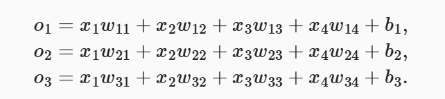
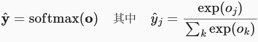

# LLM 笔记（Python 语法检索表 + 线性神经网络）

> 对应：动手学深度学习 · 代码配套 ｜ 2026-11-09 ~ 11-10（更新）
> 来源：课题组任务/LLM笔记.docx

---

PYTHON语法检索表

|     |                                       |                                                    |
|-----|---------------------------------------|----------------------------------------------------|
| \#  | 语法点                                | 在你贴的代码里                                     |
| 1   | import / from x import y as z         | from mxnet import autograd, np, npx                |
| 2   | def 定义函数、参数                    | def data\_iter(batch\_size, features, labels)      |
| 3   | return 返回多个值（元组）             | return X, y.reshape(-1, 1)                         |
| 4   | yield** 生成器**                      | data\_iter 里那个 yield                            |
| 5   | for + range(起点, 终点, 步长)         | range(0, num\_examples, batch\_size)               |
| 6   | 切片 + min()                          | indices\[i : min(i+batch\_size, n)\]               |
| 7   | 列表                                  | list(range(num\_examples))                         |
| 8   | if / break                            | 演示循环里那个 break                               |
| 9   | with** 上下文管理器**                 | with torch.no\_grad():、with autograd.record():    |
| 10  | f-string 格式化                       | f'epoch {epoch + 1}, loss {...:f}'                 |
| 11  | 函数可以当参数、列表里装张量          | sgd(\[w, b\], lr, batch\_size)                     |
| 12  | 方法调用 / 属性（面向对象的最小知识） | .shape .backward() .grad .zero\_() net\[0\].weight |
| 13  | 变量作用域（循环变量泄漏）            | 最后那个 X 是最后一批                              |
| 14  | 装饰器 / 注释标记                     | \#@save（**其实只是注释，不执行**）                |

线性神经网络

1.从零开始实现

（1）人造数据集

建立模型：

y=Xw+b+e

例如：

**def** synthetic\_data(w, b, num\_examples): *\#@save*

*"""生成y=Xw+b+噪声"""*

X = np.random.normal(0, 1, (num\_examples, len(w)))

y = np.dot(X, w) + b

y += np.random.normal(0, 0.01, y.shape)

**return** X, y.reshape((-1, 1))

true\_w = np.array(\[2, -3.4\])

true\_b = 4.2

features, labels = synthetic\_data(true\_w, true\_b, 1000)

print('features:', features\[0\],'**\\n**label:', labels\[0\])*\#里面的数字用于取样本*

2.  小批量读取数据

    在下面的代码中，我们定义一个data\_iter函数， 该函数接收批量大小、特征矩阵和标签向量作为输入，生成大小为batch\_size的小批量。 每个小批量包含一组特征和标签

**def** data\_iter(batch\_size, features, labels):

num\_examples = len(features)

indices = list(range(num\_examples))

*\# 这些样本是随机读取的，没有特定的顺序*

random.shuffle(indices)

**for** i **in** range(0, num\_examples, batch\_size):

batch\_indices = np.array(

indices\[i: min(i + batch\_size, num\_examples)\])

**yield** features\[batch\_indices\], labels\[batch\_indices\]

**别和 **true\_w** / **true\_b** 混淆：**

|                                 |                                      |                            |
|---------------------------------|--------------------------------------|----------------------------|
|                                 | 是什么                               | 训练中是否可见             |
| true\_w=\[2,-3.4\], true\_b=4.2 | 生成数据用的**真实答案**             | 不可见，只在最后对答案     |
| w, b                            | 模型**待猜的未知数**，从随机小值起步 | 就是这四个数字在被不断更新 |

\*前两节负责准备数据 这一节负责准备参数

3.4 softmax回归

分类上使用热度编码 即向量中只有一个值被设置为1，其余值均为0

\*为什么不用0，1，2区分？

模型会误认为它们之间有大小远近关系 使用向量会使得它们并列

计算条件概率使用仿射函数（类似线性代数的方程组）

特征(x) 权重(w) 注：此处权重代表不了其重要性 只能说明它对于结论的影响性的占比

b为偏置 对应输出的常数项

而w的下标代表输出/输入第几项：例：w22代表第二个输出 第二个输入

Softmax运算：

优化参数，即将数据变为非负数，统一符号，并且所有数据总和为1，梯度表现为y^（预测值）-y（实际值），保证其不会卡住可运行

（也称分配函数）

（下为模型运行笔记）

四、多层感知机
