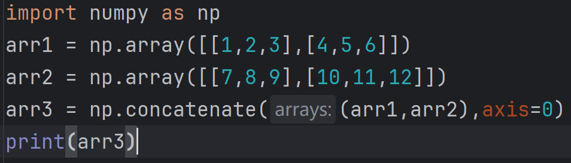
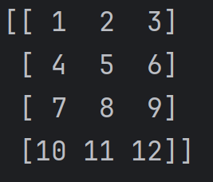
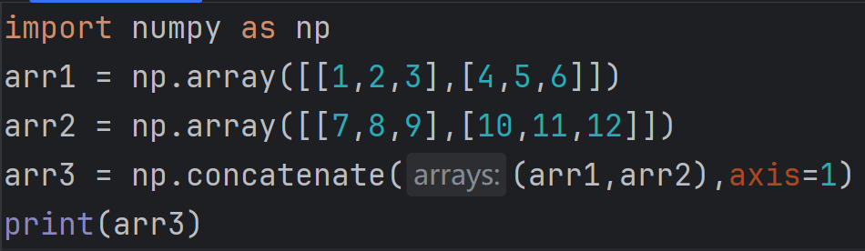
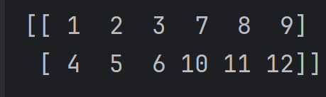
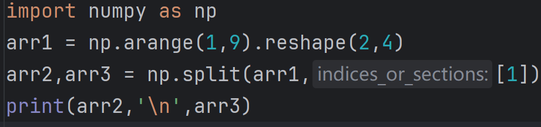
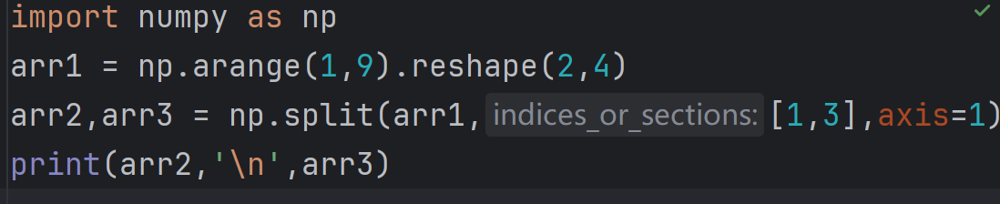
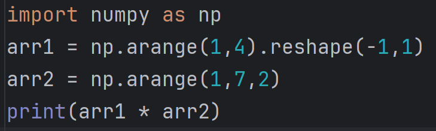
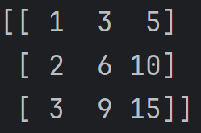

# NumPy 笔记

> 对应：第 1 周 第 4 天 · 数据基础（NumPy）
> 完成时间：2026-10-22 ~ 2026-10-29（本周，进行中）
> 来源：课题组任务/Numpy.docx

---

Arrange array reshape

矩阵转置：

矩阵名字.T

\*注意不能对矩阵转置

数组翻转

两种反转方法：上下翻转和左右翻转

向量翻转：.flipud

矩阵翻转：.filpud/filplr

数组重塑

.reshape

数组拼接

1.  向量拼接：.concatenate

2.  矩阵拼接：

```{=html}
<!-- -->
```
1.  按行拼接：

     

2.  按列拼接：

     

    数组的分裂

```{=html}
<!-- -->
```
1.  向量的分裂

2.  矩阵的分裂

```{=html}
<!-- -->
```
1.  按行分裂

    

2.  按列分裂

    

    数组的运算

    加减乘除同上

    \*\*n（n次方） //（取整） %（取余）

    数组间的运算同上

    广播

    向量与矩阵相互运算 向量会变为行矩阵

    行矩阵/列矩阵会被改为适配另一个矩阵的形式 此称为广播

    例：

     

数组的函数

向量的乘积.dot（）

全是线代。。。

数学函数.abs( )绝对值函数

.sin/.cos/.tan（三角函数）

e的x次方：.exp

Log使用换底公式除法运算

聚合函数

最大/最小值函数：max/min（加axis参数可按行/列计算 不加则算整体最大值）

求和函数：sum

均值函数：.mean

标准差函数：.std

布尔型数组

创建布尔型数组（比较）

同维数组比较或与常量比较

有关True的函数：.sum/.any/.all

sum统计True的数量 any用来查看有没有True的元素 all检查是否全部True

布尔型数组作为掩码

筛选：arr\[条件（例如：arr\>4）\]退化为向量

.where寻找需要的元素位置

数组与张量

数组转化为张量：torch.tensor(数组名)

张量转化为数组：np.array(张量名)
