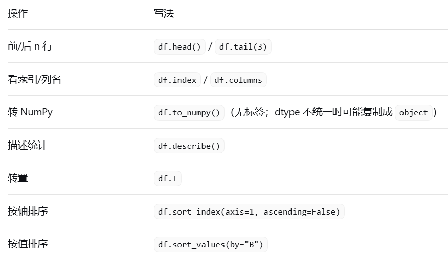
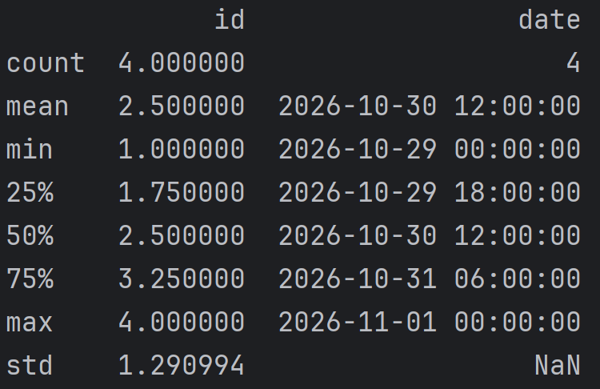

# Pandas 笔记

> 对应：第 1 周 第 4 天 · 数据基础（Pandas）
> 整理时间：2026-10-28
> 来源：课题组任务/Pandas笔记.docx

---

Pandas笔记

**必学 11 个章节（约 9 小时）**： 数据结构导论 → 基本功能 → **IO 工具** → **索引与数据选择** → **处理缺失数据** → **处理文本数据** → 分类数据 → **分组-应用-合并** → **合并/连接** → **重塑与枢透表** → UDF（按需）

1.  基础操作

    

    df.head() / df.tail(3)查看头/尾几行数据 括号内填数字

    df.index用于取索引位置 df.columns用于取列名 若要具体地按位置取 则使用df.iloc\[行,列\]

    df.Numpy 转Numpy用

    df.describe()

    Count：非空数据个数 Mean：平均值

    Min：最小值（最早值）25/50/75%：各自的百分位数

    Max：最大值（最晚值）Std：标准差：日期无法计算

    df.T 转置（横转竖）

    df.sort用法：

\[df.sort_index(axis=0) 按行号排

df.sort_index(axis=1) 按列名排

df.sort_index(axis=1, ascending=False) False降序（大到小） True升序（小到大）

df.sort_values(by=\'id\') 某个具体的量 \]
