# Python 笔记

> 对应：第 1 周 第 2 天 · Python 基础
> 完成时间：2026-10-14 ~ 2026-10-21（上周）
> 来源：课题组任务/Python笔记.docx

---

Python基础学习

笔记：

1.Type(变量)可以直接输出数据类型

2.随机数：import random(引入random包)使用random.randrange(数字范围,数字范围)可调用随机数

3.字符串：

（1）多行字符串引用三个单引号或双引号来选中

（2）可用\[ \]来访问字符串中的字符（\[2;5\]指从2到4位字符，\[-5:-2\]）

（3）for函数可一个个读取字符串中的字符

（4）len函数量取字符串长度

（5）print（"字符" in 字符串）可检查在不在字符串里面（in 或not in）

（6）if也可用于使用

（7）abs为绝对值

4.del 可用于删除某个变量

修改字符串：

1.  变量.upper()/lower() 分别为将变量大/小写 变量.strip()删除全部空格 变量.replace("旧"，"新") 变量.strip("，")拆分字符串

字符串格式化：在字符串中使用占位符{}后，即可实现字符与数字相结合的输出方式，且不改变数字原有的数据类型，若有多个即可使用逗号隔开，示意如下：

输入：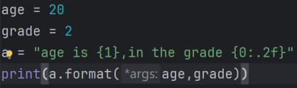 输出：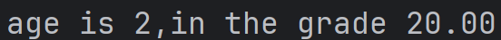

2.  还可以直接赋值

    输入：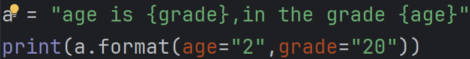输出：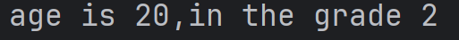

3.  反斜杠\\ \\插入非法字符，主要是某些函数名

4.  字符串方法（上网查阅）

    布尔型（true或false）：

```{=html}
<!-- -->
```
1.  大部分都是真，除了空的集合列表元组字典和len为0与数字0是false

（2）还可用于查看函数是否能正常执行（仅限于观测语法）

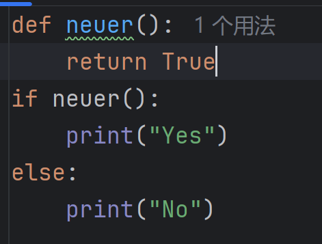

(3) 判断数据类型（isinstance(变量，类型)）

    运算：

    \*\*为幂次运算

    \(1\) 逻辑运算符：and,or,not

    \(2\) 成员运算符in

    \(3\) 按位运算符& and；\| 或；\~ 非；\^亦或；\>\>右移；\<\<左移）（二进制）

    列表

```{=html}
<!-- -->
```
(1) 可使用函数来构造列表，示意如下：

    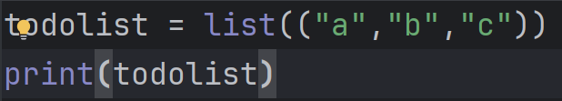

    输出与普通列表一致

(2) 列表允许拥有重复值 且数据类型可混合

(3) 列表也可更改其数值 ：

    输入：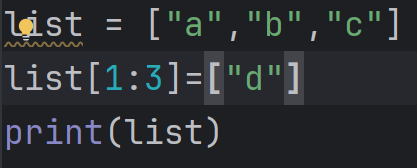输出：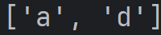

(4) 插入新元素：

    输入：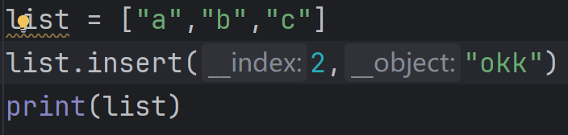输出：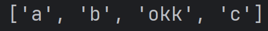

(5) 列表扩展：extend（用法同上） 删除元素：remove 删除索引定位元素：pop

    清空列表：clear

    排序：sort（阿斯卡码表）（若要反向排序则在括号中打入reverse = True）

    复制列表copy(或list2 = list（list1）)

(6) 列表检索：

    输入：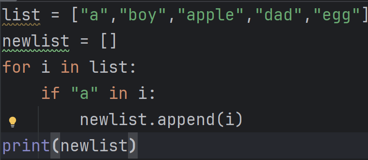输出：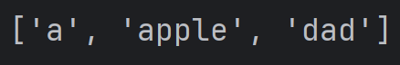

    简写版本：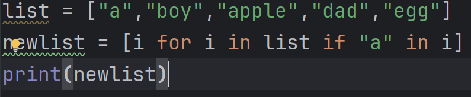

    **元组：**

```{=html}
<!-- -->
```
(1) 有序不可更改（删除 增加或改变）但是允许重复值

(2) 若元组只有一项 则在后面加上逗号

(3) 若要更改元组 则先改为列表再改回元组

(4) 元组之间相加（x+=y）

(5) 若两个元组的元素数量不同 可在某一元素前打上"\*" 则其他元素将作为列表分配给该元素

    输入：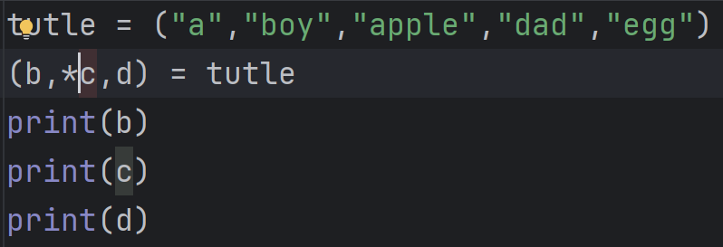 输出： 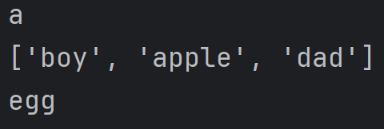

    **集合**

    集合是无序 无索引 不可改变 且不允许有重复值的

```{=html}
<!-- -->
```
(1) 由于不存在索引 只能用for循环历遍集合项

(2) 可以添加元素 使用add 两集合相加使用update 加在前面那个集合中（区别于union union是产生新的集合 如set3 = set1.union(set2)）

(3) 删去元素 使用remove或discard(多使用这个 不会报错) 使用pop将会随机删除

    **字典**

```{=html}
<!-- -->
```
(1) 有序 可变 不可重复的集合（我也不知道有无序）

(2) 若有重复项则只显示最后一个

(3) 用中括号来索引访问字典中的项目(或使用get)

    输入：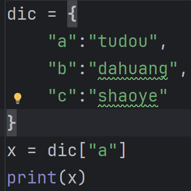 输出：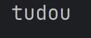

(4) 值的列表：values 项目的列表：items 用in检查是否在字典里

    添加项目使用update 用pop删除元素 popitem删除最后一个元素

    Clear清空字典 复制字典.copy()或dict（）

(5) 通过引用键名的方式来更改特定项目的值

    输入：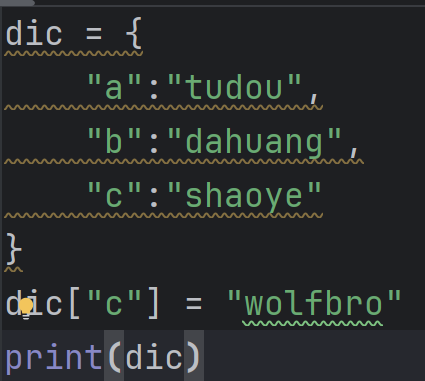 输出：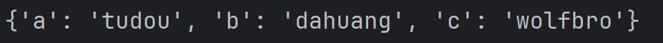

(6) for循环打印的是key的值 若要打印values则使用.values的后缀来实现

    For(x,y)可将key与values一同打印出来

    输入：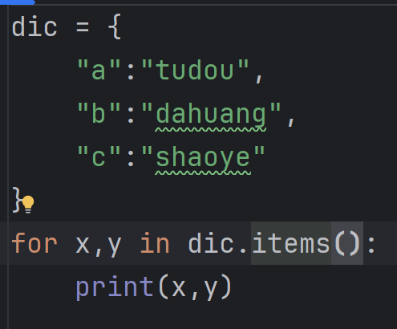输出：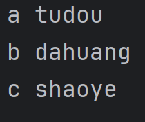

    条件语句：

```{=html}
<!-- -->
```
(1) if elif else

    循环语句：

    \(1\) while for

    \(2\) continue(跳过当前迭代前往下一个 放在循环中)

    (3)range 默认从零开始 递增1 例：range(6) 从0到5

    Try Except语句：

    测试代码块的错误

    输入：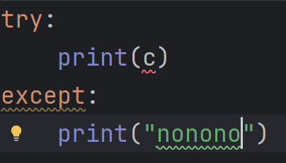输出：nonono

    Finally：无论是否引发错误都会执行

    函数

    Def创建函数 调用：函数名加括号

    调用的参数数量必须等于定义数量

    在调用变量前加入\*可加入任意数量的变量（可通过\[ \]索引数字来取元素）

    用key = value语法发送参数 使参数顺序无关紧要

    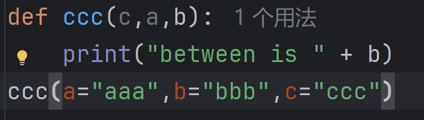

    一颗星和两颗星的区别：

    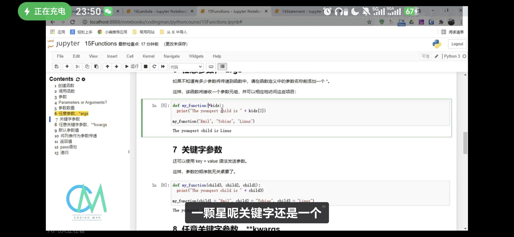

    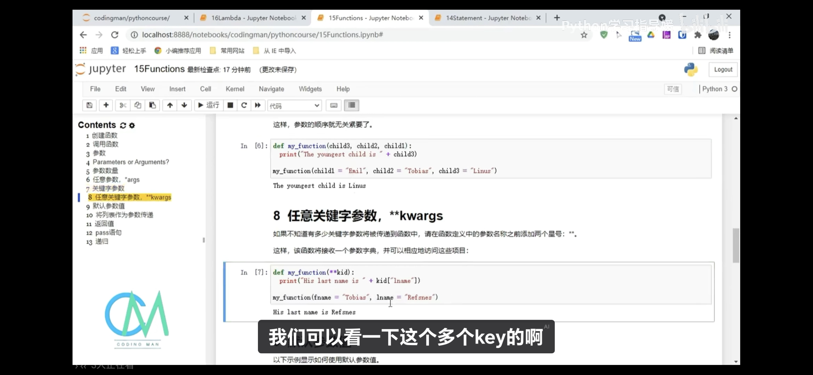

    不调用函数则其使用定义的默认值

    输入：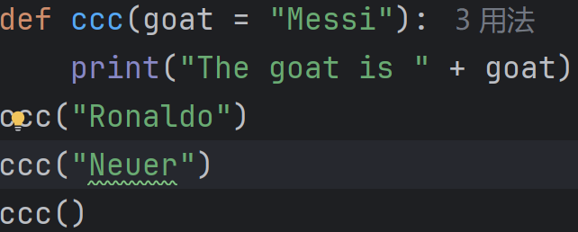 输出：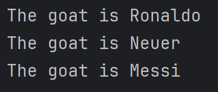

    列表也可以作参数返回值使用 ！！！与print的区别：return是返回的函数值 还可以保存变量供调用 但return后函数的程序不会再进行 print打印后就消失了

    Pass语句为空函数 避免报错

    递归：允许函数自己调用自己

    拉姆达函数

    执行表达式并返回结果

    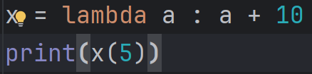

    区别于def：只是一行小逻辑

    类/对象

    class（类）：将数据与函数打包在一起

    Init()函数：类的内置函数 其中name可理解为self的属性 其本身不再是变量

    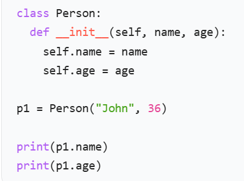

    对象方法：可以在类中创建一个方法：def myfunc(变量)：直接在变量后加.myfunc就可以运用该方法

    可单独删去对象或对象属性(del)

    父类/子类：定义子类时直接在括号中填写父类的名称 后＋pass可完全继承父类的各项属性

    子类自身也可拥有自己的init函数 但是也要计入父类的init函数（父类名称.\_init\_()）

    同理 子类也可定义自己的方法

    \*\*\*迭代器

    调用_iter_函数可进行初始化 比如赋值等操作

    调用_next_函数在iter的基础上运行 每调用一次就运行一次

    若要停止迭代 则加入if/else语句来判断 并把raise StopIteration置于else下面

    模块

    创建模块：将所需代码保存在一个为.py的文件中

    使用模块：使用import（空格）＋文件名

    导入模块：from （文件名） import （函数）

    文件处理

    打开文件有四种不同的方法（模式）：

    \"r\" - 读取 - 默认值。打开一个文件进行读取，如果文件不存在则报错

    \"a\" - Append - 打开一个文件进行追加，如果文件不存在则创建该文件

    \"w\" - 写入 - 打开一个文件进行写入，如果文件不存在则创建该文件

    \"x\" - Create - 创建指定的文件，如果文件存在则返回错误

    \"b\" - 二进制 - 二进制模式（例如图像）

    \"t\" - 文本 - 默认值。文本模式

f = open(\"demofile.txt\") 等同于 f = open(\"demofile.txt\", \"rt\")

文件读取print(f.read())

括号中加入数字代表只读几个字符 使用readline代替read则是读一行

！！！记得关闭文件：文件名.close（）

要删除文件，必须导入 OS 模块，并运行其 os.remove () 函数：

import os

os.remove(\"demofile2.txt\")

为避免出现错误，需要在尝试删除文件之前检查该文件是否存在：

import os

if os.path.exists(\"demofile.txt\"):

os.remove(\"demofile.txt\")

else:

print(\"The file does not exist\")
